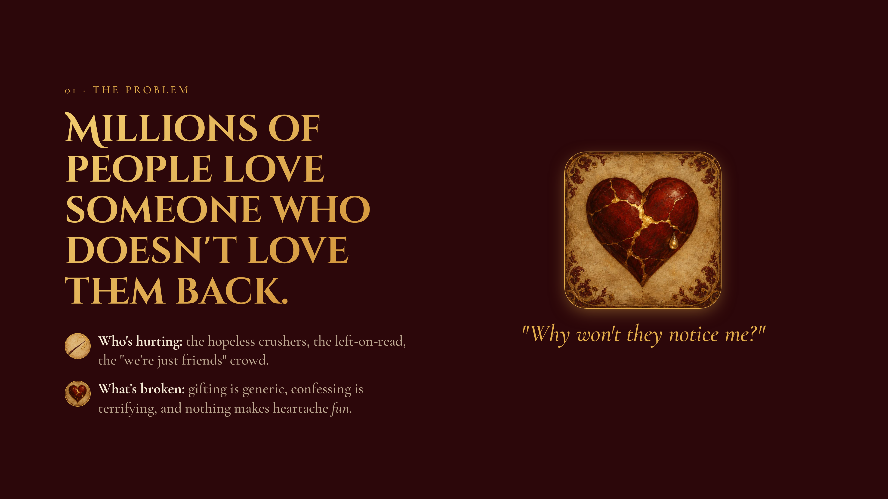
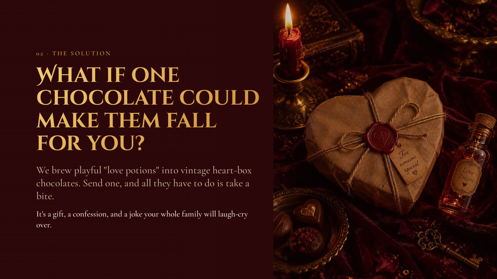
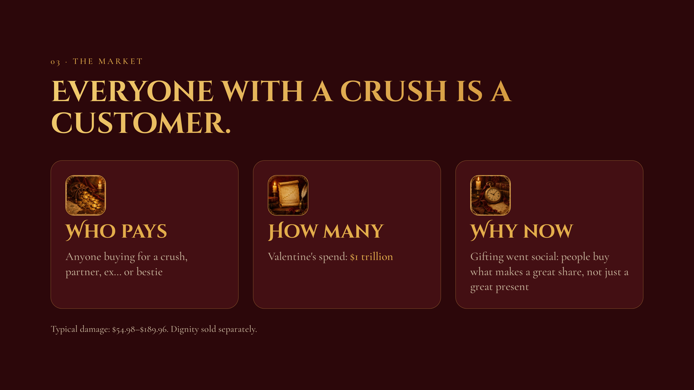
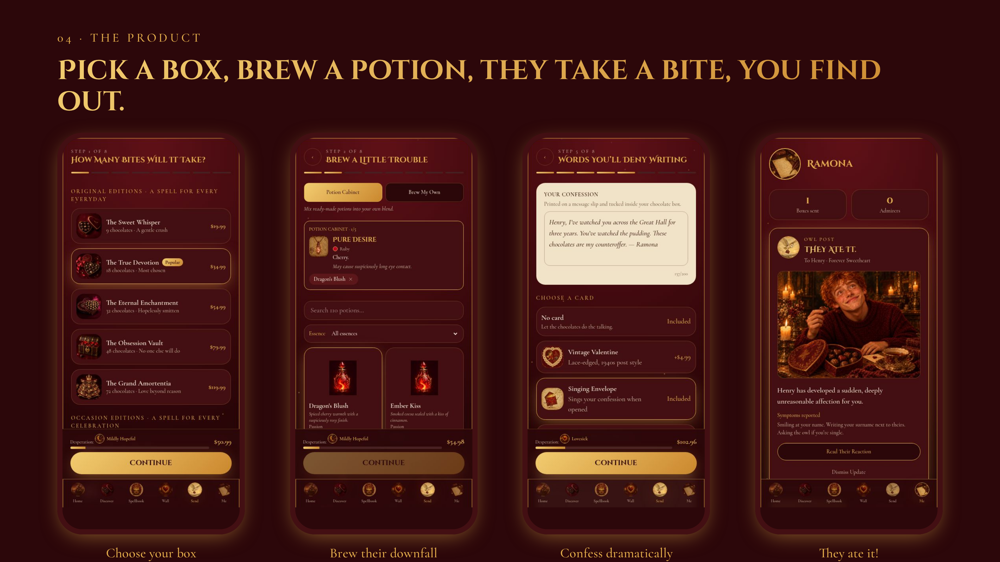
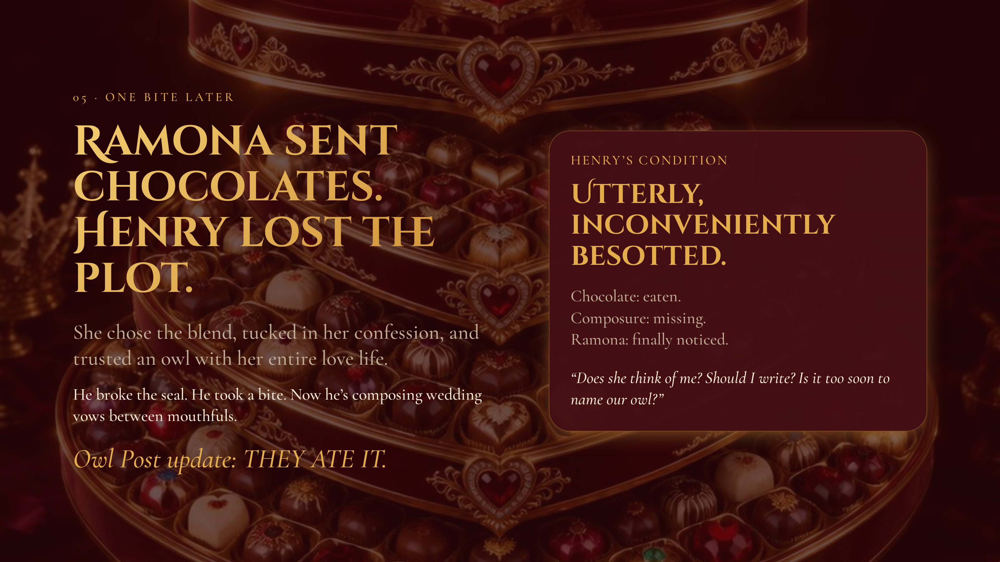
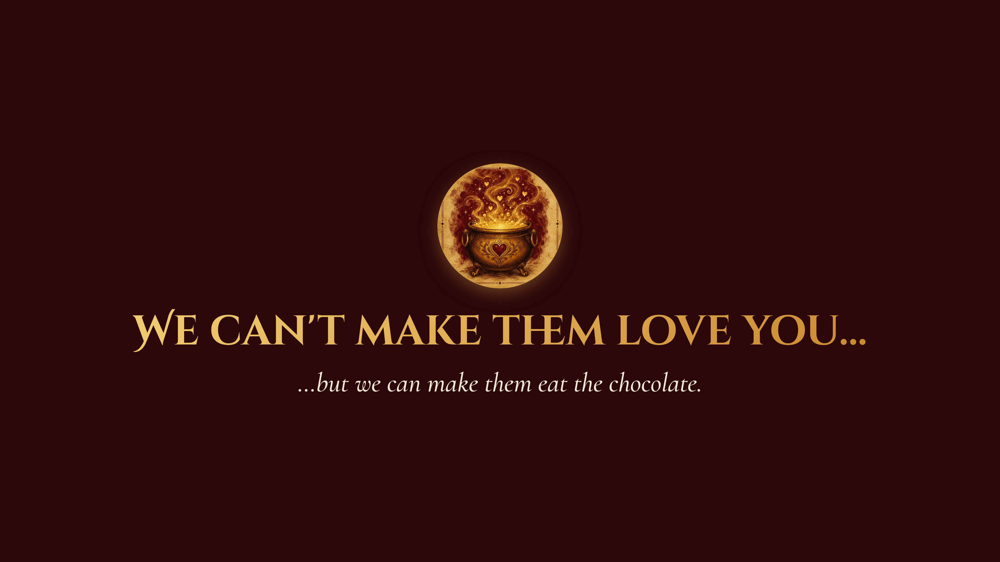

# 💌 Amortentia Post
## 🎯 Objective  
This project draws inspiration from the iconic Harry Potter and the Half-Blood scene where Ron Weasley falls under the spell of a love potion after eating chocolates from a heart-shaped box. Combined with Brent Chase’s Unethical Hackathon concept of emotional hijacking through love, the idea takes a playful twist on romance. Ironically built with Lovable, ChatGPT, and Github the app turns the desperation for love into a magical chocolate shop selling love-potion-infused treats. After all, for secret admirers hoping to win someone’s heart, all it takes is one bite. 

## 🎬 Inspiration  
### Harry Potter and the Half-Blood's In Love With Who? Scene

Click the image above to watch the video. 

## 🛠️ Tools  
Lovable, ChatGPT, Github 

## 📱 App  
This project has a fully functional app available at the following link: [Launch App](https://redefiningvicky.github.io/amortentia-post-0764d734/#/) 

## 📢 Pitch  
This project has a fully functional pitch available at the following link: [Launch Pitch](https://redefiningvicky.github.io/amortentia-post-0764d734/#/pitch?slide=1) 

<strong>View Pitch Format</strong>

1. Problem  
2. Solution  
3. Market  
4. Product  
5. Company Name  
6. Smile  

  

